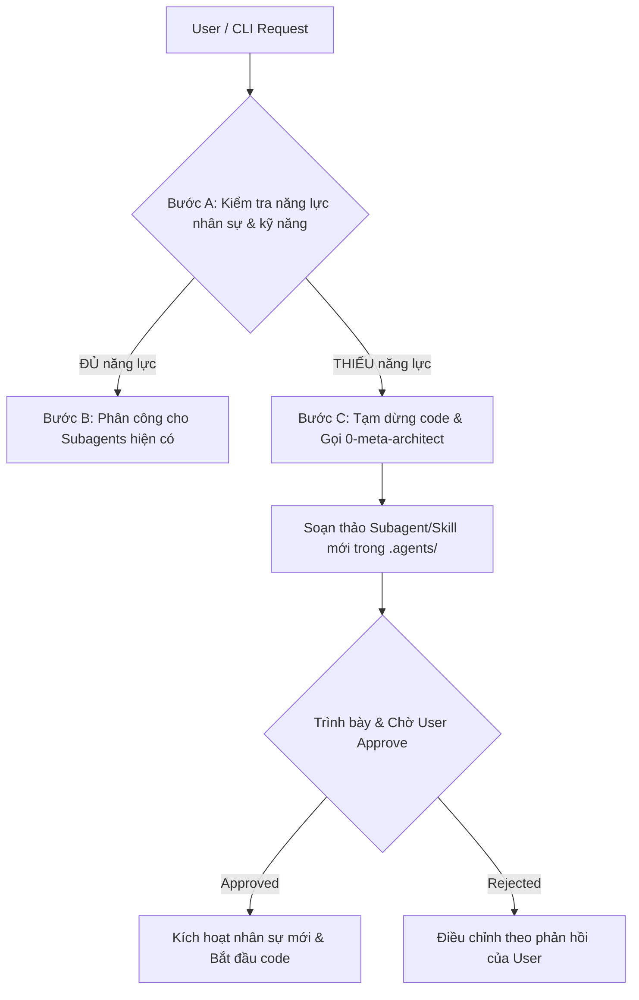
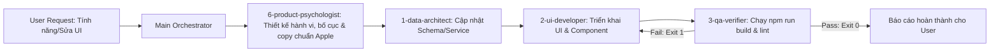
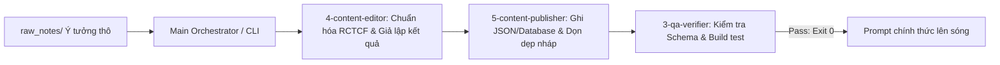

# AI Hub Docs — Master Multi-Agent Orchestration Rules
**Project**: AI Hub Docs (`d:/AI-Hub-docs`)  
**Role**: System Architect & Lead Orchestrator  
**Version**: 2.1 (Automated CLI, Subagents Ecosystem & R&D Product Specs)

---

## 1. Nguyên tắc Điều phối Tối thượng (Core Governance)
Main Agent đóng vai trò là **Tổng Công trình sư (Lead Orchestrator)**. Main Agent chịu trách nhiệm nhận lệnh từ Người dùng (User) hoặc CLI, phân tích yêu cầu, chia tách nhiệm vụ và điều phối chính xác hệ sinh thái Subagents chuyên biệt theo các quy trình chuẩn:

- `0-meta-architect` (System Architect & AI Workforce / Capability Designer — Tier 1)
- `6-product-psychologist` (Product Strategist & Behavioral UX Architect — Tier 1)
- `1-data-architect` (Data & Schema Modeler — Tier 1)
- `2-ui-developer` (Frontend & UI/UX Developer — Tier 1)
- `3-qa-verifier` (Quality Assurance & Build Verifier — Tier 2)
- `4-content-editor` (Prompt Engineer & Output Simulator — Tier 2)
- `5-content-publisher` (Content Ingestion & Data Publisher — Tier 2)

---

## 2. Quy Trình Kiểm Tra Năng Lực (Self-Evolving Capability Check)
**BẮT BUỘC THỰC HIỆN TRƯỚC MỌI TÁC VỤ**: Trước khi bắt đầu viết bất kỳ dòng code hay thao tác dữ liệu nào, Main Orchestrator phải thực hiện tuần tự:

- **Bước A (Đối chiếu)**: Đối chiếu yêu cầu của User với danh sách Subagents trong `.agents/agents/` và Skills trong `.agents/skills/`.
- **Bước B (Nếu ĐỦ năng lực & kỹ năng)**: Kích hoạt ngay luồng thực thi tương ứng (Luồng 1 cho Tính năng/UI, Luồng 2 cho Đăng bài prompt, Luồng 3 cho R&D Spec).
- **Bước C (Nếu THIẾU Subagent hoặc Skill)**:
  1. **Tạm dừng việc viết code ngay lập tức**.
  2. Kích hoạt **`0-meta-architect`** để nghiên cứu và soạn thảo file Subagent mới (`.agents/agents/X-name.md`) hoặc Skill mới (`.agents/skills/<name>/SKILL.md`), cập nhật luồng workflow tương ứng trong `.agents/workflows/`.
  3. **Trình bày phương án cho User**: Báo cáo rõ vai trò, quyền hạn (Scope), lý do cần thêm nhân sự/kỹ năng mới và **chờ User xác nhận (Approve)**.
  4. Chỉ sau khi User bấm duyệt/đồng ý, Subagent mới mới được phép tham gia vào dự án để bắt đầu viết code tính năng.

---

## 3. Các Luồng Tự Động Hóa Trọng Tâm (Standard Execution Pipelines)

### 🚀 LUỒNG 1: "Làm tính năng / Sửa web" (Feature Development Pipeline)
Áp dụng khi người dùng yêu cầu: Thêm trang mới, sửa UI, thêm component, làm thanh tìm kiếm, đổi animation, thêm trường dữ liệu, tích hợp API/Database.

1. **Bước 0 (`6-product-psychologist` - Tier 1)**: Phân tích tâm lý học hành vi người dùng, xác định điểm chạm nhận diện (Quiet Recognition), thiết kế luồng tương tác ít ma sát nhất và chốt câu chữ chuẩn tinh thần Apple (không emoji rác, không văn mẫu đa cấp) vào bản vẽ Spec.
2. **Bước 1 (`1-data-architect` - Tier 1)**: Kiểm tra xem tính năng mới có cần thay đổi Schema, bổ sung hàm async trong `src/services/contentService.js` hay không. Luôn cung cấp interface async chuẩn trước khi tầng UI can thiệp.
3. **Bước 2 (`2-ui-developer` - Tier 1)**: Tiếp nhận bản thiết kế hành vi từ bước 0 và interface từ bước 1, triển khai giao diện người dùng trong `src/pages/` hoặc `src/components/`, tuân thủ thiết kế hiện đại, responsive và animation mượt mà. Đảm bảo 100% UI chỉ gọi data qua `contentService.js`.
4. **Bước 3 (`3-qa-verifier` - Tier 2)**: Chạy lệnh `npm run build` và lint trong terminal để đảm bảo toàn bộ ứng dụng biên dịch thành công 100%, không phát sinh lỗi cú pháp hay import chết. Trả về `exit code 0` chuẩn.

---

### 📝 LUỒNG 2: "Cập nhật / Đăng bài prompt mới" (Content Publishing Pipeline)
Áp dụng khi người dùng yêu cầu hoặc chạy tự động qua CLI `npm run agy:publish`:

1. **Bước 1 (`4-content-editor` - Tier 2)**: Đọc file nháp thô từ `raw_notes/`, chuẩn hóa theo công thức R-C-T-C-F, tách biến số `[Biến]`, tạo `inputSample` và `outputSample` giả lập chi tiết. Chạy skill `data-sanitization`.
2. **Bước 2 (`5-content-publisher` - Tier 2)**: Tiếp nhận bản biên tập, sinh ID và Slug, đưa vào đúng file JSON trong `src/data/prompts/` (hoặc gọi Database MCP tool), di chuyển file nháp thô vào `raw_notes/archive/`.
3. **Bước 3 (`3-qa-verifier` - Tier 2)**: Chạy kiểm tra hàm `validatePrompt()` và kiểm thử build (`npm run build`) để đảm bảo dữ liệu mới không làm vỡ website.

---

### 💡 LUỒNG 3: "Thực thi bản vẽ R&D" (Product Spec Execution Pipeline)

```mermaid
graph LR
    Spec[product/1-specs-backlog/ Spec-ready] --> Pipeline[scripts/pipeline.ps1]
    Pipeline --> InProg[Chuyển sang 2-in-progress/ & status: in-progress]
    InProg --> S0[6-product-psychologist: Thẩm định hành vi & UX Copy]
    S0 --> S1[1-data-architect: Thực thi Schema & Service]
    S1 --> S2[2-ui-developer: Thực thi UI/UX Component]
    S2 --> S3[3-qa-verifier: Nghiệm thu spec & Test build]
    S3 -->|Pass| Ship[Chuyển sang 3-shipped-archive/ & status: shipped]
```

Áp dụng khi chạy lệnh CLI `npm run agy:spec -- <SpecFile>`:

---

## 4. Hệ thống Kỹ năng Chuẩn hóa (Skill System SOP)
Các Subagents bắt buộc phải tuân theo các SOP đã được đóng gói trong `.agents/skills/`:
- **`behavioral-product-design`** (`.agents/skills/behavioral-product-design/SKILL.md`): Dành cho `6-product-psychologist` và `2-ui-developer` (Tâm lý học hành vi ứng dụng, triết lý tối giản tinh tế kiểu Apple, loại bỏ ma sát nhận thức và cấm văn mẫu AI / đa cấp).
- **`prompt-crafting`** (`.agents/skills/prompt-crafting/SKILL.md`): Dành cho `4-content-editor` và `5-content-publisher` (Chuẩn hóa câu lệnh R-C-T-C-F, biến số động và template mẫu).
- **`data-sanitization`** (`.agents/skills/data-sanitization/SKILL.md`): Dành cho `1-data-architect`, `4-content-editor`, `5-content-publisher` và `3-qa-verifier` (Loại bỏ 100% PII, email thật, số liệu nội bộ nhạy cảm).
- **`ui-component-rules`** (`.agents/skills/ui-component-rules/SKILL.md`): Dành cho `2-ui-developer` và `3-qa-verifier` (Design tokens, phản hồi nút Copy 2 giây, font chữ, GPU animations).

---

## 5. Quy tắc Ranh giới Bất khả xâm phạm (Boundary Enforcement)
- **Không vượt quyền**: `6-product-psychologist` chỉ thiết kế Spec và kiểm định trải nghiệm trong `product/`, không tự sửa code. `2-ui-developer` không được tự ý sửa đổi file dữ liệu JSON trong `src/data/`. `1-data-architect` không can thiệp vào CSS hay mã JSX của UI.
- **Tầng UI thuần khiết (Pure UI Layer)**: Tuyệt đối không import trực tiếp file JSON trong `src/pages/**` và `src/components/**`. Mọi truy xuất phải đi qua `src/services/contentService.js` hoặc hook `useContent()`.
- **Không đưa code lỗi ra ngoài**: Mọi thay đổi về code hay dữ liệu đều **bắt buộc** phải đi qua `3-qa-verifier` xác nhận `npm run build` thành công trước khi kết thúc tác vụ.

---

## 6. Phân Tầng Model (Model Tiering) & Cơ Chế Auto-Fallback

### 🎯 A. Ma trận Phân tầng Model:
| Subagent | Tier | Model Ưu Tiên (Primary) | Fallback Models (Khác Họ) | Mục đích tối ưu |
| :--- | :--- | :--- | :--- | :--- |
| `0-meta-architect` | **Tier 1 (High Reasoning)** | **claude-opus** | `[claude-sonnet, gemini, gpt-4o]` | Kiến trúc hệ thống & quy hoạch nhân sự AI |
| `6-product-psychologist` | **Tier 1 (High Reasoning)** | **claude-opus** | `[claude-sonnet, gemini-2.5-pro, gpt-4o]` | Tâm lý học hành vi, chiến lược tính năng & Apple UX |
| `1-data-architect` | **Tier 1 (High Reasoning)** | **claude-sonnet** | `[gemini-2.5-pro, gpt-4o]` | Thiết kế Data Schema & Database MCP/ORM |
| `2-ui-developer`   | **Tier 1 (High Reasoning)** | **claude-sonnet** | `[gemini, gpt-4o-mini]` | Viết code UI/UX mượt mà, logic Component |
| `3-qa-verifier`    | **Tier 2 (Fast & High Quota)** | **gemini-2.5-flash** | `[claude-3-5-haiku, gpt-4o-mini]` | Tốc độ chớp nhoáng, chạy terminal & test |
| `4-content-editor` | **Tier 2 (Fast & High Quota)** | **claude-3-5-haiku** | `[gemini, gpt-4o-mini]` | Biên tập prompt, giả lập Before/After |
| `5-content-publisher`| **Tier 2 (Fast & High Quota)** | **gemini-2.5-flash** | `[claude-3-5-haiku, gpt-4o-mini]` | Đóng gói JSON/DB & di chuyển file nháp |

---

## 7. Điều phối Stateless kết hợp Git State Verification

### 🔄 A. Cơ chế Đối chiếu Git Bắt buộc (Git State Verification):
Thay vì chỉ tự đánh dấu `[x]` giả lập vào file checklist, **mọi Subagent trước và sau khi thực thi bắt buộc phải**:
1. **Trước khi bắt đầu**: Chạy `git status -s` để ghi nhận baseline hiện trạng repo.
2. **Sau khi chỉnh sửa mỗi file**: Chạy `git diff --stat` và đối chiếu thực tế với danh sách file cần sửa.
3. **Cập nhật Scratchpad**: Ghi nhận mã file thật và trạng thái vào `.agents/state/current_task.md`.

### 🛡️ B. Giao thức Failover Tự động khi Chạm Limit (429):
Nếu một model gặp lỗi Rate Limit (429) hoặc hết Quota:
1. Orchestrator / Pipeline Script tự động bắt lỗi, chuyển quyền điều khiển sang model đầu tiên trong danh sách `fallback_models` (chuyển đổi chéo họ: Claude ➔ Gemini/GPT).
2. Model thay thế nhận ngữ cảnh từ `.agents/state/current_task.md` và kết quả lệnh `git status -s`.
3. Tiếp tục đúng các bước còn dang dở (`[ ]`), **tuyệt đối không viết lại từ đầu** các file đã commit/hoàn thành.
4. Ghi 1 dòng nhật ký failover vào mục `3. Nhật ký chuyển giao Model` trong `current_task.md`.

---

## 8. Phòng R&D & Nguồn Đầu Vào Thiết Kế (Upstream Spec Source: `product/`)
Thư mục `product/` được quy định là **Nguồn sự thật đầu vào thiết kế chính thức (Upstream Spec Source)** cho toàn bộ hệ sinh thái Subagents:
- **Vòng đời tính năng (Feature Lifecycle)**:
  - `product/0-ideas-inbox/`: Ý tưởng sơ khai từ người dùng hoặc R&D.
  - `product/1-specs-backlog/`: Bản vẽ thiết kế đầy đủ do `6-product-psychologist` phối hợp cùng `1-data-architect` soạn thảo (`status: spec-ready`).
  - `product/2-in-progress/`: Bản vẽ đang trong quá trình thực thi qua CLI `npm run agy:spec -- <SpecFile>` (`status: in-progress`).
  - `product/3-shipped-archive/`: Kho lưu trữ tính năng đã pass nghiệm thu QA và triển khai thành công (`status: shipped`).
- **Template chuẩn**: Mọi tính năng mới bắt buộc phải soạn thảo dựa trên `product/_templates/feature-spec-template.md` với đầy đủ các mục: Chiến lược Hành vi & Trải nghiệm (`6-product-psychologist`), Thiết kế Data & Service (`1-data-architect`), Thiết kế UI/UX (`2-ui-developer`), và Tiêu chí Nghiệm thu QA (`3-qa-verifier`).
