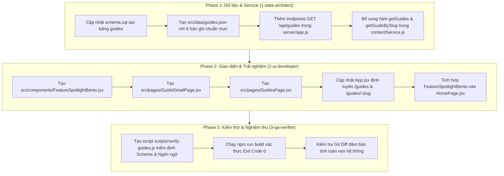

# [FEAT-004] AI Feature Spotlight & Advanced Workflows

> **Tóm tắt giá trị**: Giúp nhân viên doanh nghiệp nhận diện và kích hoạt các tiện ích nâng cao tích hợp sẵn trên các nền tảng AI phổ biến (Gemini Gems, ChatGPT Projects, NotebookLM, Canvas, M365 Copilot) thông qua giao diện Bento Visual Tiles tối giản tại Trang chủ và Trang Chi Tiết 5 phần chuyên sâu, xóa bỏ hoàn toàn rào cản thao tác lặp lại và nhầm lẫn với Prompt thông thường.  
> **Trạng thái**: `spec-ready` | **Độ ưu tiên**: `high` | **Ngày tạo**: 2026-10-17

---

## 1. Chiến lược Hành vi & Trải nghiệm (`6-product-psychologist`)
*Phụ trách: `6-product-psychologist` (Tier 1 / Assigned Skill: `behavioral-product-design`)*

### 1.1. Nỗi đau nhận diện & Điểm nghẽn thao tác (Quiet Recognition)
Khi quan sát thói quen làm việc thực tế của nhân sự khối văn phòng tại các doanh nghiệp, chúng tôi nhận thấy 3 rào cản hành vi nghiêm trọng:

1. **Ma sát lặp bối cảnh (Context Groundhog Day)**:
   - Mỗi lần mở cuộc trò chuyện mới trên ChatGPT hoặc Gemini, người dùng phải gõ lại từ đầu: *"Tôi là nhân viên pháp chế của công ty X, hãy tuân thủ biểu mẫu Y, không được dùng từ ngữ Z..."*.
   - Sự mệt mỏi này khiến họ dần bỏ qua việc thiết lập chuẩn mực, dẫn đến câu trả lời của AI ngày càng chung chung và không dùng được vào việc thật.
2. **Ảo giác nhầm lẫn giữa "Công thức Prompt" và "Môi trường Tính năng"**:
   - Người dùng thường nhầm tưởng các tính năng như Gemini Gems hay ChatGPT Projects chỉ là những đoạn văn bản dài dán vào ô chat.
   - Khi giao diện hiển thị chúng dưới dạng thẻ bài viết thông thường, người dùng chỉ lướt qua mà không hiểu rằng đây là một **khối không gian làm việc chuyên biệt có bộ nhớ dài hạn và tài liệu nền tảng đi kèm**.
3. **Rào cản trang trắng (Blank Sheet Paralysis)**:
   - Khi vào màn hình tạo Gem hoặc Project, các công cụ hiện ra một biểu mẫu trống trơn (*Instructions*, *Knowledge*). Người dùng không biết phải nạp tài liệu gì và viết câu lệnh hướng dẫn thế nào cho chuẩn mực doanh nghiệp, dẫn đến việc bỏ dở.

### 1.2. Giải pháp Kiến trúc Trải nghiệm: Phân tách 2 tầng nhận thức

#### Tầng 1: Ngoài Trang chủ (`src/pages/HomePage.jsx`) — Bento Visual Tiles (`src/components/FeatureSpotlightBento.jsx`)
- **Triết lý hiển thị**: Cực kỳ ít chữ, giàu tính thị giác chuẩn Apple, tạo khoảng thở lớn ngay dưới phần Hero. Tuyệt đối không đổ các đoạn văn mô tả dài gây quá tải nhận thức.
- **Bố cục Bento Grid 4 ô (hoặc 3-4 ô thích ứng)**:
  Mỗi Tile là một khối đồ họa tương tác gọn gàng, chỉ chứa đúng 3 thành phần thông tin theo nguyên tắc 3 giây nhận thức:
  1. **Nhãn công cụ nhỏ gọn (Eyebrow Badge)**: `Gemini · Gems`, `ChatGPT · Projects`, `NotebookLM`, `Canvas & Artifacts`.
  2. **Một câu Title ngắn, sắc, chạm đúng nỗi đau (8–12 chữ)**:
     - *Gemini Gems*: *"Dạy AI quy tắc của bạn đúng một lần. Dùng mãi về sau."*
     - *ChatGPT Projects*: *"Gom mọi tài liệu và cuộc trò chuyện của một đầu việc về chung một bộ nhớ."*
     - *NotebookLM*: *"Hỏi đáp trên hàng trăm trang hợp đồng, trích dẫn chính xác tới từng dòng."*
     - *Canvas & Artifacts*: *"Bôi đen để sửa trực tiếp một đoạn nhỏ mà không làm hỏng cả văn bản dài."*
  3. **Một hình minh họa giao diện thu nhỏ (Mini UI Visual Preview) ngay trong lòng Tile**:
     - Dựng hoàn toàn bằng CSS/Tailwind tinh xảo (không dùng ảnh chụp màn hình mờ nhạt):
       - *Gems Preview*: Khung thẻ trợ lý chuyên gia với huy hiệu quy chế và 2 chip tài liệu đính kèm (`Quy_che_2026.pdf`, `Bieu_mau_chuan.docx`).
       - *Projects Preview*: Cấu trúc thư mục dự án với icon bộ nhớ đồng bộ và danh sách 3 tài liệu tài chính đang được AI ghi nhớ.
       - *NotebookLM Preview*: Đoạn trích dẫn văn bản pháp lý với các số tham chiếu nguồn `[1]`, `[2]` nổi bật nhấp nháy êm ái khi hover.
       - *Canvas Preview*: Trình soạn thảo hai cột thu nhỏ với thanh công cụ điều chỉnh độ dài văn bản và đoạn chọn văn bản đang được bôi đen trực quan.
- **Hành vi tương tác**:
  - Nhấp trực tiếp vào bất kỳ Tile nào: Điều hướng thẳng sang **Trang Chi Tiết riêng (`/guides/:slug`)**.
  - Nút chuyển hướng phụ: *"Xem tất cả tiện ích →"* đặt tại góc phải tiêu đề khu vực, dẫn tới trang danh mục đầy đủ (`/guides`).

#### Tầng 2: Trang Chi Tiết Chuyên Biệt (`src/pages/GuideDetailPage.jsx` — Route `/guides/:slug`)
Khác hoàn toàn với cấu trúc trang công thức Prompt, Trang Chi Tiết Tiện Ích được quy hoạch theo **bố cục 5 phần thoáng đãng**, dẫn dắt người đọc qua từng nấc thang tâm lý:

- **Phần 1 — Định nghĩa bản chất & Minh họa cơ chế (Nó là gì?)**:
  - Diễn giải 2–3 câu súc tích bằng ngôn ngữ đời thường, trả lời thẳng vào bản chất kỹ thuật mà không dùng thuật ngữ rườm rà.
  - Kèm **Sơ đồ cơ chế hoạt động trực quan (Visual Architecture Diagram)** khổ lớn, sáng sủa:
    $$\text{Lớp Cố Định 1 Lần (Quy tắc + File mẫu)} + \text{Lớp Yêu Cầu Mỗi Ngày (Lệnh ngắn)} = \text{Đầu Ra Chuẩn Doanh Nghiệp}$$
- **Phần 2 — Sự khác biệt trong công việc thực tế (Nó giải quyết vấn đề gì?)**:
  - Bảng đối chiếu trực diện 2 cột: *Khi chỉ dùng ô chat thường* vs *Khi đã bật tính năng này*.
  - **3 Bài toán ứng dụng sát sườn trong doanh nghiệp** phân chia theo phòng ban (Ban Giám Đốc, Pháp chế, Nhân sự, Tài chính, Vận hành) để người đọc nhìn thấy chính công việc hàng ngày của mình.
- **Phần 3 — Quy trình tích hợp từng bước kèm Minh họa vị trí trên màn hình (Cách tích hợp)**:
  - Chia làm 3 bước tuần tự rõ ràng:
    - *Bước 1 (Tìm & Bật ở đâu)*: Chỉ dẫn vị trí nút bấm trên menu giao diện công cụ (`uiLocationHint`) kèm thông tin gói tài khoản yêu cầu (Miễn phí, Plus, Enterprise).
    - *Bước 2 (Nạp tài liệu & ngữ cảnh gì vào)*: Danh sách gợi ý các file tài liệu nghiệp vụ có sẵn trong công ty cần gắn vào (`filesToPrepare`).
    - *Bước 3 (Cách gọi ra dùng mỗi ngày)*: Hướng dẫn ghim lên thanh bên, phím tắt gọi nhanh hoặc chia sẻ không gian làm việc cho đồng nghiệp.
- **Phần 4 — Bộ khung cài đặt mẫu (Starter Kit — Đưa sẵn để không phải tự nghĩ)**:
  - Khối mã hiển thị văn bản hướng dẫn nền tảng (`starterBlueprint`) đã được chuẩn hóa cho doanh nghiệp.
  - Tích hợp nút `Sao chép cấu hình` có phản hồi trạng thái 2 giây (`Đã sao chép`).
  - Nút hành động trực tiếp: `Mở công cụ thực hành ngay ↗` mở tab mới dẫn thẳng đến đường dẫn tạo tính năng của dịch vụ AI (Gemini Gems, ChatGPT Projects, NotebookLM...).
- **Phần 5 — Lưu ý an toàn dữ liệu & Các công thức Prompt dùng kèm**:
  - Hộp cảnh báo phân loại dữ liệu doanh nghiệp an toàn (liên kết tới `/governance`).
  - Lưới gợi ý 2–3 công thức Prompt liên quan (`DocRecipeCard`) đã được tối ưu để chạy trên môi trường tính năng này.

### 1.3. Quy chuẩn Ngôn ngữ & Micro-copy chuẩn Apple (Anti-AI-Slop)
- Tuyệt đối không dùng emoji trang trí trong tiêu đề, badge và nút bấm (biểu tượng lửa, tên lửa, tia chớp, lấp lánh).
- Tuyệt đối không dùng từ ngữ phóng đại, tiếp thị giật gân (*"Siêu tốc", "Bí mật", "X10 năng suất", "Đỉnh cao", "Vũ khí tối thượng"*).
- Không sử dụng dấu chấm than (`!`).
- Mẫu câu chuẩn mực cho các thành phần giao diện:
  - Tiêu đề khu vực: `"Tiện ích tích hợp sẵn"`
  - Phụ đề: `"Khai thác chiều sâu của các công cụ quen thuộc để giảm bớt thao tác lặp lại."`
  - Nút điều hướng: `"Xem hướng dẫn tích hợp"` hoặc `"Xem tất cả tiện ích →"`
  - Nút hành động trang chi tiết: `"Sao chép cấu hình mẫu"`, `"Mở công cụ thực hành ↗"`
  - Trạng thái thành công: `"Đã lưu vào bộ nhớ tạm"`

---

## 2. Thiết kế Dữ liệu & Service (`1-data-architect`)
*Phụ trách: `1-data-architect` (Tier 1 / Data Sanitization & Enterprise Schema)*

### 2.1. Cấu trúc Bảng `guides` trong Cơ sở Dữ liệu (`server/db/schema.sql`)
Bổ sung bảng `guides` vào hệ thống PostgreSQL / PGlite thống nhất:

```sql
CREATE TABLE IF NOT EXISTS guides (
    id VARCHAR(50) PRIMARY KEY,
    slug VARCHAR(100) UNIQUE NOT NULL,
    title VARCHAR(255) NOT NULL,
    tool_badge VARCHAR(100) NOT NULL,
    tool_name VARCHAR(50) NOT NULL,
    feature_name VARCHAR(100) NOT NULL,
    tagline VARCHAR(255) NOT NULL,
    summary TEXT NOT NULL,
    is_featured BOOLEAN DEFAULT TRUE,
    display_order INTEGER DEFAULT 1,
    account_tier_required VARCHAR(100) NOT NULL,
    what_it_is JSONB NOT NULL,
    problem_solved JSONB NOT NULL,
    integration_steps JSONB NOT NULL,
    starter_blueprint JSONB NOT NULL,
    safety_and_governance JSONB NOT NULL,
    related_prompt_ids JSONB NOT NULL DEFAULT '[]'::jsonb,
    updated_at VARCHAR(20) NOT NULL,
    created_at TIMESTAMP DEFAULT CURRENT_TIMESTAMP
);

CREATE INDEX IF NOT EXISTS idx_guides_slug ON guides(slug);
CREATE INDEX IF NOT EXISTS idx_guides_featured ON guides(is_featured);
```

### 2.2. Schema TypeScript / JSDoc Chi Tiết
Định dạng dữ liệu trả về cho Client (`src/types/guide.d.ts` hoặc JSDoc):

```typescript
export interface GuideVisualStep {
  stepNumber: number;
  title: string;
  description: string;
  uiLocationHint: string;
  filesToPrepare: string[];
}

export interface GuideScenario {
  department: string;
  title: string;
  manualPain: string;
  acceleratedSolution: string;
}

export interface GuideStarterBlueprint {
  title: string;
  description: string;
  instructionsText: string;
  externalToolUrl: string;
  externalToolLabel: string;
}

export interface GuideSafety {
  dataClassification: string;
  guidelines: string[];
  governanceUrl: string;
}

export interface GuideItem {
  id: string;
  slug: string;
  title: string;
  toolBadge: string;
  toolName: string;
  featureName: string;
  tagline: string;
  summary: string;
  isFeatured: boolean;
  displayOrder: number;
  accountTierRequired: string;
  whatItIs: {
    overview: string;
    coreDifference: string;
    architectureDiagram: {
      layerOne: string;
      layerTwo: string;
      layerResult: string;
    };
  };
  problemSolved: {
    withoutFeature: string;
    withFeature: string;
    scenarios: GuideScenario[];
  };
  integrationSteps: GuideVisualStep[];
  starterBlueprint: GuideStarterBlueprint;
  safetyAndGovernance: GuideSafety;
  relatedPromptIds: string[];
  relatedPrompts?: any[];
  updatedAt: string;
}
```

### 2.3. Dữ liệu Mẫu 6 Tiện Ích Doanh Nghiệp (`src/data/guides.json`)
Hệ thống chuẩn bị sẵn 6 bản ghi chất lượng cao, tuân thủ 100% nguyên tắc kiểm duyệt dữ liệu an toàn (`data-sanitization`):

1. **`gemini-gems` (Gemini · Gems)**:
   - `id`: `GDE-001`, `slug`: `gemini-gems`
   - `toolBadge`: `Gemini · Gems`, `tagline`: `Dạy AI quy tắc của bạn đúng một lần. Dùng mãi về sau.`
   - `accountTierRequired`: `Google Workspace for Business hoặc Google One AI Premium`
   - `overview`: Tiện ích tạo trợ lý AI chuyên biệt cho từng đầu việc, cho phép lưu sẵn vai trò, tài liệu mẫu và quy chuẩn định dạng một lần duy nhất.
   - `scenarios`:
     - *Ban Giám Đốc*: Trợ lý thẩm tra tờ trình, tự động rà soát chỉ số ROI và tính khả thi theo mẫu phê duyệt nội bộ.
     - *Pháp chế*: Trợ lý kiểm tra hợp đồng dịch vụ theo danh mục điều khoản loại trừ đã được ban hành.
     - *Nhân sự*: Trợ lý giải đáp nội quy và chính sách phúc lợi dựa trên Sổ tay nhân viên mới nhất.
   - `starterBlueprint`: Bộ quy chuẩn System Instructions cho Gem Thẩm tra Văn bản Quản trị.

2. **`chatgpt-projects` (ChatGPT · Projects)**:
   - `id`: `GDE-002`, `slug`: `chatgpt-projects`
   - `toolBadge`: `ChatGPT · Projects`, `tagline`: `Gom mọi tài liệu và cuộc trò chuyện của một đầu việc về chung một bộ nhớ.`
   - `accountTierRequired`: `ChatGPT Plus, Team hoặc Enterprise`
   - `overview`: Không gian làm việc khép kín dành riêng cho một dự án, chia sẻ chung danh mục tài liệu tham chiếu và hướng dẫn vận hành cho tất cả các cuộc trao đổi liên quan.
   - `scenarios`:
     - *Tài chính*: Hồ sơ soát xét báo cáo tài chính nhiều năm và phân tích lưu chuyển tiền tệ hợp nhất.
     - *Vận hành*: Quản lý dự án chuyển đổi quy trình ERP với toàn bộ biên bản cuộc họp và biểu đồ quy trình.
     - *Ban Giám Đốc*: Dự án mở rộng chi nhánh mới, lưu trữ toàn bộ nghiên cứu thị trường và hồ sơ pháp lý mặt bằng.
   - `starterBlueprint`: Cấu trúc hướng dẫn nền tảng cho Project Quản lý Tài chính & Phân tích Chi phí.

3. **`notebooklm-sources` (NotebookLM)**:
   - `id`: `GDE-003`, `slug`: `notebooklm-sources`
   - `toolBadge`: `NotebookLM`, `tagline`: `Hỏi đáp trên hàng trăm trang hợp đồng, trích dẫn chính xác tới từng dòng.`
   - `accountTierRequired`: `Tài khoản Google (Miễn phí hoặc Google Workspace)`
   - `overview`: Hệ thống tổng hợp tri thức grounded hoàn toàn trên tài liệu của người dùng, loại bỏ nguy cơ thông tin sai lệch bằng cách trích dẫn số trang và dòng văn bản gốc cho mọi câu trả lời.
   - `scenarios`:
     - *Pháp chế*: So chiếu sự sai khác giữa 4 phiên bản hợp đồng khung và hồ sơ mời thầu quốc tế.
     - *Vận hành*: Tra cứu nhanh quy trình xử lý sự cố thiết bị từ 10 cuốn cẩm nang vận hành kỹ thuật.
     - *Nhân sự*: Phân tích kết quả khảo sát mức độ gắn kết nhân viên và tổng hợp xu hướng nguyện vọng theo phòng ban.
   - `starterBlueprint`: Khung định hướng phân tích đa tài liệu và lập bảng so sánh điều khoản rủi ro.

4. **`canvas-artifacts` (Canvas & Artifacts)**:
   - `id`: `GDE-004`, `slug`: `canvas-artifacts`
   - `toolBadge`: `Canvas & Artifacts`, `tagline`: `Bôi đen để sửa trực tiếp một đoạn nhỏ mà không làm hỏng cả văn bản dài.`
   - `accountTierRequired`: `ChatGPT (Canvas) hoặc Claude (Artifacts) - Bản miễn phí & trả phí`
   - `overview`: Giao diện làm việc hai cột trực quan, cho phép thao tác chỉnh sửa trực tiếp trên từng đoạn văn bản hoặc mã lệnh cụ thể mà không bắt AI phải tạo lại toàn bộ tài liệu từ đầu.
   - `scenarios`:
     - *Ban Giám Đốc*: Trau chuốt từng đoạn thông điệp trong Thư gửi Cổ đông thường niên.
     - *Pháp chế*: Sửa đổi câu chữ của điều khoản phạt vi phạm mà giữ nguyên toàn bộ cấu trúc hợp đồng.
     - *Vận hành*: Tinh chỉnh từng bước công việc trong quy trình SOP giao nhận hàng hóa.
   - `starterBlueprint`: Mẫu cấu hình soạn thảo văn bản phối hợp có gắn chú thích kiểm soát thay đổi.

5. **`m365-copilot-bizchat` (Microsoft 365 Copilot · Business Chat)**:
   - `id`: `GDE-005`, `slug`: `m365-copilot-bizchat`
   - `toolBadge`: `Microsoft 365 · BizChat`, `tagline`: `Khai thác dữ liệu nội bộ qua email, lịch họp và SharePoint theo thời gian thực.`
   - `accountTierRequired`: `Microsoft 365 Copilot Enterprise Add-on`
   - `overview`: Trợ lý điều phối doanh nghiệp kết nối trực tiếp với Microsoft Graph, cho phép tổng hợp thông tin phân tán trong Outlook, Teams và SharePoint với quyền bảo mật của người dùng.
   - `scenarios`:
     - *Ban Giám Đốc*: Tóm tắt các quyết định then chốt từ các cuộc họp giao ban tuần qua trên Teams.
     - *Tài chính*: Tổng hợp tiến độ duyệt dự toán ngân sách từ chuỗi email trao đổi với các Trưởng bộ phận.
     - *Vận hành*: Tìm kiếm biên bản bàn giao kho hàng gần nhất được lưu trên thư mục SharePoint của chi nhánh.
   - `starterBlueprint`: Cấu trúc câu lệnh tổng hợp thông tin đa kênh Microsoft Graph cho quản lý điều hành.

6. **`claude-projects-style-guide` (Claude · Projects & Style Guide)**:
   - `id`: `GDE-006`, `slug`: `claude-projects-style-guide`
   - `toolBadge`: `Claude · Projects`, `tagline`: `Duy trì giọng văn thương hiệu và văn phong phân tích nhất quán cho toàn bộ dự án.`
   - `accountTierRequired`: `Claude Pro, Team hoặc Enterprise`
   - `overview`: Môi trường kiểm soát văn phong chuyên nghiệp, gắn sẵn bộ quy chuẩn nhận diện thương hiệu và tiêu chuẩn biên tập để đảm bảo mọi ấn phẩm đầu ra đều đồng nhất phong cách.
   - `scenarios`:
     - *Truyền thông & PR*: Soạn thảo thông cáo báo chí và bài viết đối ngoại theo đúng tone of voice thương hiệu.
     - *Nhân sự*: Chuẩn hóa toàn bộ thông báo tuyển dụng và thư mời nhận việc theo văn hóa tổ chức.
     - *Ban Giám Đốc*: Soạn thảo các bài phát biểu nội bộ truyền cảm hứng với phong cách điềm đạm, mạch lạc.
   - `starterBlueprint`: Bộ quy chuẩn Style Guide & Tone of Voice dành cho văn bản quản trị doanh nghiệp.

### 2.4. Triển khai API Endpoints trong Hono Backend (`server/app.js`)
- `GET /api/guides`: Trả về danh sách tất cả các tiện ích. Hỗ trợ query `?featured=true` để lấy 4 bản ghi ngoài trang chủ.
- `GET /api/guides/:idOrSlug`: Trả về chi tiết tiện ích theo ID hoặc slug. Tự động truy vấn bảng `prompts` để gắn kết các `relatedPrompts` đầy đủ thông tin.

### 2.5. Bổ sung Service Layer (`src/services/contentService.js`)
- `getGuides()`: Lấy danh sách tiện ích từ API, tự động chuyển đổi sang mảng tĩnh từ `src/data/guides.json` khi chạy ở chế độ tĩnh.
- `getFeaturedGuides()`: Lấy danh sách tiện ích nổi bật phục vụ Bento Showcase.
- `getGuideBySlug(slug)`: Lấy chi tiết tiện ích kèm mảng `relatedPrompts` đã đối chiếu.

---

## 3. Thiết kế Giao diện & UI/UX (`2-ui-developer`)
*Phụ trách: `2-ui-developer` (Tier 1 / Assigned Skill: `ui-component-rules`)*

### 3.1. Danh mục Component & Thay đổi Tệp tin
1. **Tạo mới `src/components/FeatureSpotlightBento.jsx`**: Component hiển thị Bento Visual Tiles ngoài Trang chủ.
2. **Tạo mới `src/pages/GuideDetailPage.jsx`**: Trang Chi Tiết Tiện Ích chuẩn 5 phần thoáng đãng.
3. **Tạo mới `src/pages/GuidesPage.jsx`**: Trang Danh mục toàn bộ Tiện Ích Nâng Cao (`/guides`).
4. **Cập nhật `src/App.jsx`**: Bổ sung các Route:
   - `/guides` ➔ `<GuidesPage />`
   - `/guides/:slug` ➔ `<GuideDetailPage />`
5. **Cập nhật `src/pages/HomePage.jsx`**:
   - Tích hợp `<FeatureSpotlightBento />` ngay bên dưới Hero section (trước phần *Guided paths*).
6. **Cập nhật `src/components/Navbar.jsx`**:
   - Bổ sung hoặc điều hướng liên kết phù hợp, hỗ trợ người dùng truy cập trực tiếp danh mục tiện ích.

### 3.2. Đặc tả Chi tiết: Bento Visual Tiles (`src/components/FeatureSpotlightBento.jsx`)
- **Vị trí trên trang**: Nằm ngay dưới Hero section của `HomePage.jsx`.
- **Cấu trúc Lưới (Bento Layout)**:
  - Khung bao: `max-w-7xl mx-auto px-4 sm:px-6 lg:px-8 py-12`.
  - Tiêu đề khu vực:
    - Eyebrow: `text-xs font-semibold text-indigo-600 uppercase tracking-wider` ("Tiện ích tích hợp sẵn").
    - Headline: `text-xl sm:text-2xl font-bold text-slate-900 tracking-tight` ("Khai thác chiều sâu công cụ AI").
    - Liên kết góc phải: `"Xem tất cả tiện ích →"` dẫn đến `/guides`.
  - Lưới Bento 4 ô:
    - Desktop: Grid 4 cột (hoặc 2 cột lớn cân xứng với chiều cao đồng nhất `h-full`).
    - Mỗi Tile là thẻ Link `group relative bg-white border border-slate-200/80 rounded-2xl p-6 hover:border-slate-300 hover:shadow-[0_8px_24px_rgba(0,0,0,0.06)] transition-all duration-200 flex flex-col justify-between`.
- **3 Thành phần Bắt buộc trong mỗi Tile**:
  1. **Nhãn công cụ nhỏ gọn**:
     - `text-[11px] font-semibold text-slate-500 uppercase tracking-wider mb-2` (ví dụ: `Gemini · Gems`, `ChatGPT · Projects`).
  2. **Một câu Title ngắn, sắc (8–12 chữ)**:
     - `text-base font-bold text-slate-900 group-hover:text-indigo-600 transition-colors leading-snug mb-5`.
  3. **Mini UI Visual Preview (Đồ họa giao diện thu nhỏ)**:
     - Dựng hoàn toàn bằng CSS/Tailwind tạo cảm giác ứng dụng cao cấp:
     - *Tile 1 (Gemini Gems)*:
       - Hộp nền `bg-slate-50/80 rounded-xl p-3 border border-slate-100 space-y-2`.
       - Dòng tên trợ lý: Chấm tròn gradient tím-xanh, chữ đậm `"Trợ lý Thẩm tra Hợp đồng"`.
       - 2 Chip tài liệu đính kèm: Icon file nhỏ, nhãn `"Quy_che_2026.pdf"` và `"Mau_bieu.docx"`.
     - *Tile 2 (ChatGPT Projects)*:
       - Hộp nền `bg-slate-50/80 rounded-xl p-3 border border-slate-100`.
       - Dòng thư mục: Icon folder màu xanh đá, nhãn `"Dự án Tái cấu trúc Vận hành"`.
       - Khung nhỏ chứa 2 thẻ hội thoại dùng chung bộ nhớ: `"Kế hoạch Q3"` và `"Dự toán ngân sách"`.
     - *Tile 3 (NotebookLM)*:
       - Hộp nền `bg-slate-50/80 rounded-xl p-3 border border-slate-100`.
       - Dòng văn bản giả lập: 2 dòng chữ xám nhạt với số trích dẫn `[1]` và `[2]` được bo góc tròn nền xanh nhạt `bg-sky-100 text-sky-700 font-mono text-[10px] px-1 py-0.5`.
     - *Tile 4 (Canvas & Artifacts)*:
       - Khung chia đôi thu nhỏ: Cột trái là danh mục mục lục, cột phải là văn bản có 1 dòng đang được chọn bôi đen nền `bg-indigo-100/80 text-indigo-900` kèm menu điều chỉnh nhỏ phía trên.

### 3.3. Đặc tả Chi tiết: Trang Chi Tiết (`src/pages/GuideDetailPage.jsx`)
- **Khung chứa**: `max-w-5xl mx-auto px-4 sm:px-6 lg:px-8 py-10 space-y-12`.
- **Breadcrumb & Header**:
  - Breadcrumb: `Trang chủ / Tiện ích / [Tên Tiện Ích]`.
  - Tool badge: Badge bo tròn trang nhã `bg-slate-100 text-slate-700 text-xs font-semibold px-3 py-1`.
  - Tiêu đề lớn: `text-3xl font-extrabold text-slate-900 tracking-tight`.
  - Tagline đanh thép: `text-lg text-slate-600 font-medium leading-relaxed`.
- **Nội dung 5 phần phân tách rõ ràng**:
  1. **Phần 1: Định nghĩa bản chất & Minh họa cơ chế**:
     - Đoạn văn 2–3 câu súc tích.
     - Hộp Sơ đồ Cơ chế (`Visual Architecture Diagram`): Nền sáng `bg-slate-50 border border-slate-200/80 rounded-2xl p-6 sm:p-8`. Gồm 3 khối nối với nhau bằng dấu cộng `+` và mũi tên `➔`:
       - Khối 1: `Cài cố định 1 lần` (Tài liệu nội bộ, quy chế, checklist).
       - Khối 2: `Làm việc mỗi ngày` (Câu lệnh ngắn, câu hỏi cụ thể).
       - Khối 3: `Đầu ra chuẩn mực` (Đúng văn phong, số liệu có căn cứ, không ảo giác).
  2. **Phần 2: Sự khác biệt trong công việc thực tế**:
     - Bảng đối chiếu 2 cột: Cột trái `Khi dùng chat thông thường` (nền xám nhạt), Cột phải `Khi đã bật tính năng này` (nền trắng viền xanh tím nhẹ).
     - Lưới 3 thẻ kịch bản thực tế theo phòng ban (`Ban Giám Đốc`, `Pháp chế / Nhân sự`, `Tài chính / Vận hành`): Thẻ nền trắng hiển thị rõ ràng bài toán thủ công và cách tiện ích giải quyết triệt để.
  3. **Phần 3: Quy trình tích hợp 3 bước kèm vị trí nút bấm**:
     - Bước 1: `Tìm & Bật ở đâu` — Nêu rõ vị trí trên menu giao diện kèm badge loại tài khoản yêu cầu (`Free`, `Plus`, `Enterprise`).
     - Bước 2: `Nạp tài liệu & ngữ cảnh gì` — Khung chỉ dẫn danh mục tài liệu công ty cụ thể cần chuẩn bị sẵn (`filesToPrepare`).
     - Bước 3: `Cách gọi ra sử dụng mỗi ngày` — Hướng dẫn ghim cố định và phím tắt gọi nhanh khi làm việc.
  4. **Phần 4: Bộ khung cài đặt mẫu (Starter Kit)**:
     - Khung hiển thị nội dung `starterBlueprint` định dạng khối văn bản rõ ràng.
     - Thanh công cụ phía trên gồm: Tiêu đề bản mẫu, Nút `Sao chép cấu hình` (có hiệu ứng đổi chữ thành `Đã sao chép` trong 2 giây).
     - Nút phụ: `Mở công cụ thực hành ngay ↗` mở liên kết dịch vụ ngoài trong tab mới.
  5. **Phần 5: Lưu ý an toàn dữ liệu & Các công thức Prompt dùng kèm**:
     - Hộp nhắc nhở an toàn dữ liệu doanh nghiệp viền màu đá phiến (`slate-200`), trích dẫn quy tắc bảo mật từ `/governance`.
     - Lưới hiển thị các thẻ `DocRecipeCard` liên quan, cho phép người dùng bấm sao chép câu lệnh hoặc mở xem chi tiết prompt tương ứng.

---

## 4. Kế hoạch Thực thi Từng bước & Tiêu chí Nghiệm thu (`3-qa-verifier`)
*Phụ trách: `3-qa-verifier` (Tier 2 / Gatekeeper)*

### 4.1. Lộ trình Thực thi Chi tiết cho Phiên Tối



- **Bước 1 (`1-data-architect`)**:
  1. Thêm DDL bảng `guides` vào `server/db/schema.sql`.
  2. Tạo tệp `src/data/guides.json` chứa 6 bản ghi đầy đủ cấu trúc 5 phần.
  3. Cập nhật `server/db/index.js` (hàm `mapRowToGuide`, khởi tạo seed dữ liệu mẫu khi start).
  4. Cập nhật `server/app.js` bổ sung 2 route API (`/api/guides`, `/api/guides/:idOrSlug`).
  5. Bổ sung các hàm async trong `src/services/contentService.js`.
- **Bước 2 (`2-ui-developer`)**:
  1. Xây dựng `src/components/FeatureSpotlightBento.jsx` chuẩn Bento Visual Tiles với Mini UI Preview bằng CSS.
  2. Xây dựng `src/pages/GuideDetailPage.jsx` hiển thị đầy đủ 5 phần kiến trúc.
  3. Xây dựng `src/pages/GuidesPage.jsx` liệt kê toàn bộ 6 tiện ích với bộ lọc theo nền tảng.
  4. Cập nhật `src/App.jsx` bổ sung 2 routes mới.
  5. Cập nhật `src/pages/HomePage.jsx` nhúng `FeatureSpotlightBento` ngay dưới Hero.
- **Bước 3 (`3-qa-verifier`)**:
  1. Viết script `scripts/verify-guides.js` kiểm tra 100% bản ghi không chứa emoji rác, không chứa dấu chấm than (`!`), không vi phạm quy tắc an toàn dữ liệu.
  2. Chạy `node scripts/verify-guides.js` và `npm run build` để kiểm tra compile.
  3. Kiểm tra kiểm thử thủ công hiển thị responsive trên 3 kích thước màn hình (Mobile, Tablet, Desktop).

### 4.2. Acceptance Criteria Checklist (Tiêu chí Nghiệm thu Tuyệt đối)
- [ ] **Bento Grid Trang chủ**:
  - [ ] Đặt ngay dưới Hero section của `HomePage.jsx`.
  - [ ] Bố cục Bento Grid hiển thị đúng 4 tiện ích nổi bật.
  - [ ] Mỗi thẻ chỉ chứa đúng 3 phần: Tool badge, Câu Title ngắn sắc (8-12 chữ), Mini UI Preview dựng bằng Tailwind.
  - [ ] Nhấp vào thẻ điều hướng chính xác đến `/guides/:slug`. Nút liên kết phụ dẫn tới `/guides`.
- [ ] **Trang Chi Tiết Tiện Ích (`/guides/:slug`)**:
  - [ ] Hiển thị đầy đủ và thoáng đãng 5 phần nội dung.
  - [ ] Phần 1 có Sơ đồ Cơ chế trực quan 3 khối.
  - [ ] Phần 2 có so sánh Chat thường vs Bật tính năng và 3 kịch bản doanh nghiệp sát sườn.
  - [ ] Phần 3 có 3 bước tích hợp kèm gợi ý vị trí nút bấm và file cần chuẩn bị.
  - [ ] Phần 4 có khối cấu hình mẫu, nút Sao chép phản hồi 2 giây, nút Mở công cụ ngoài tab mới.
  - [ ] Phần 5 có hộp an toàn dữ liệu và gợi ý công thức Prompt liên quan.
- [ ] **Chất lượng Ngôn ngữ & Thẩm mỹ**:
  - [ ] 0 emoji trang trí gây xao nhãng (như lửa, tên lửa, tia chớp, lấp lánh).
  - [ ] 0 từ ngữ phóng đại kiểu đa cấp ("vũ khí tối thượng", "siêu tốc", "bí mật", "x10").
  - [ ] 0 dấu chấm than (`!`) trong toàn bộ bản ghi và tiêu đề giao diện.
- [ ] **Kỹ thuật & Build**:
  - [ ] 100% dữ liệu được gọi qua hàm async của `contentService.js` và hook `useContent()`, không import JSON trực tiếp trong component giao diện.
  - [ ] Lệnh `npm run build` hoàn thành với `exit code 0`, không có warning JSX hoặc lỗi routing.

---

## 5. Hướng dẫn Lệnh Chạy Thực thi Nhanh (Cho Phiên Tối)
Khi User mở máy ở nhà vào buổi tối, có thể triển khai tiếp ngay lập tức theo các lệnh sau:

```bash
# 1. Kiểm tra trạng thái Git
git status -s

# 2. Khởi chạy môi trường phát triển để bắt đầu code
npm run dev

# 3. Sau khi hoàn thành Phase 1 & 2, chạy kiểm định QA:
node scripts/verify-guides.js
npm run build
```
